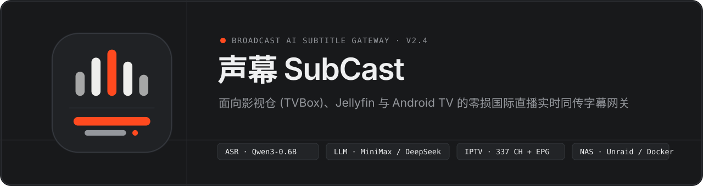
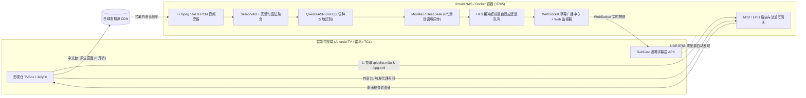

<p align="center">
  
</p>

<p align="center">
  
  
  
  
</p>

**声幕 SubCast** 是一款专为家庭 NAS（Unraid / Docker）与智能电视（**影视仓 TVBox**、**Jellyfin**、**Kodi**）打造的 **零画质损耗国际电视直播实时同传字幕网关**。

当电视切换至英文、日语、韩语、法语、德语、西语、俄语或阿语直播频道（如 BBC News、CNN、Sky News、Bloomberg、NHK World、France 24、DW、Al Jazeera 等）时，网关自动旁路拉取音频流，在本地通过 **Alibaba Qwen3-ASR-0.6B** 完成 30 语种语音识别与智能断句，结合 **MiniMax / DeepSeek** 滑动上下文窗口实时译为地道中文，并通过 **HLS 播放器缓冲超前补偿算法** 与电视端透明悬浮层实现声画同步的双语字幕呈现。

---

## 核心特性

- **零画质损耗旁路架构（Zero-Transcode Sidecar）**
  - **中文频道毫秒级直连**：央视、卫视、港澳台及地方频道（228 条流）直接由播放器原生直连，不经过任何转码或算力消耗。
  - **外语频道按需唤醒**：仅当电视切入外语频道（109 条国际主流新闻与纪实流）时自动拉起 FFmpeg 16kHz 音频旁路；退出频道满空闲阈值后自动休眠释放 CPU。
- **30 语种 + 22 方言全自动语音识别（Qwen3-ASR-0.6B + Silero-VAD）**
  - 采用 **`Qwen3-ASR-0.6B (int8)` ONNX 量化架构**（由 `sherpa-onnx` 高性能 C++ 运行时驱动），免除庞大的 PyTorch/CUDA 依赖，无需独立显卡即可在 NAS CPU 上实现百毫秒级推理；支持英、日、韩、法、德、西、俄、阿等 30 种语言盲测识别与内置标点恢复。
  - 配合 **未完句语法悬停检测**（过滤英/法/德/西语连词、介词、关系代词结尾的半截呼吸停顿），确保送入大模型的每一句都是完整语义单元。
- **滑动语境大模型同传（MiniMax M3.1-Flash / MiniMax M3 / DeepSeek）**
  - 维护最近 6 句直播上下文窗口，自动纠正在新闻、财经、体育直播中的同音专有名词误差，并按中文母语叙事语序重组长难句。
  - 内置 `CTranslate2` 离线翻译引擎作为无网/无 Key 兜底。
- **HLS 播放器缓冲自适应对齐（Auto Buffer Sync）**
  - 动态解析上游 M3U8 切片时长，实时计算电视播放器缓冲超前量 $T_{\text{lead}}$ 与 AI 管线耗时 $T_{\text{pipe}}$，自动补偿延迟差值：
    $$\Delta T_{\text{wait}} = \max\left(0,\; T_{\text{lead}} - T_{\text{pipe}} + T_{\text{offset}}\right)$$
- **开箱即用 337 路直播源（212 合并频道）+ 在线/本地双模 EPG 节目单**
  - 内置精选 212 个独立电视频道（共 337 条多主备直播流，含央视、卫视、港澳台、4K 超高清及 50+ 全球主流外语新闻台）。
  - **频道同源智能合并与一键换源**：Web 控制台自动聚合同名主备源（显示 `N 源` 计数与 `换源` 按钮），搭配零外部依赖的 **播控呼号微标（Call-Sign Monogram）**（`CCTV1`、`FHD`、`BBC`、`NHK` 等），彻底告别第三方外链台标 404 裂图。
  - **内置 4 大知名 EPG 预设源 + 在线同步聚合**：一键切换 `聚合双源 · 推荐`、`112114 极速源`、`范明明 Fanmingming`、`epg.pw 港澳台+国际` 或填入任意自定义 `.xml` / `.xml.gz` 在线地址，自动增量合并、去重并注入生成的 M3U 头部 `url-tvg`。
  - 同时提供本地 **XMLTV (`/epg.xml` / `/epg.xml.gz`)** 与 **影视仓 DIYP (`/epg?ch={name}&date={date}`)** 双协议节目单接口。
- **Android TV 零配置透明悬浮字幕端**
  - 仅 `24.4 KB` 的轻量级原生 APK，开机通过局域网 `UDP 8766` 广播自动发现 NAS 网关，无背景黑框遮挡、无焦点抢占，直接叠加于影视仓或 Jellyfin 画面之上。

---

## 系统架构



---

## 快速部署：Unraid NAS 与 Docker

### 方式一：Unraid WebUI 模板一键导入（推荐）

1. 将仓库中的 [`unraid-template.xml`](./unraid-template.xml) 复制到 Unraid 闪存目录：
   ```bash
   /boot/config/plugins/dockerMan/templates-user/my-subcast.xml
   ```
2. 进入 Unraid WebUI → **Docker** → **Add Container** → 在 **Template** 下拉菜单中选择 **`subcast`**。
3. 确认挂载路径后点击 **Apply** 即可启动，点击容器图标选择 **WebUI** 即可打开 `http://<Unraid-IP>:8765` 控制台。

### 方式二：Docker CLI 一键启动

```bash
docker run -d \
  --name subcast \
  --restart unless-stopped \
  --net=host \
  -e TZ=Asia/Shanghai \
  -e HF_ENDPOINT=https://hf-mirror.com \
  -e LINGUARELAY_PORT=8765 \
  -e LINGUARELAY_UDP_PORT=8766 \
  -v /mnt/user/appdata/subcast/models:/app/models \
  -v /mnt/user/appdata/subcast/data:/app/data \
  alansundy/subcast:latest
```

### 方式三：Docker Compose 启动

```bash
docker compose up -d
```

### 环境变量说明

| 变量名 | 默认值 | 说明 |
| :--- | :--- | :--- |
| `LINGUARELAY_PORT` | `8765` | Web 控制台、M3U/EPG 订阅与 HLS 流代理端口 |
| `LINGUARELAY_UDP_PORT` | `8766` | Android TV 悬浮字幕端局域网 UDP 自动发现端口 |
| `LINGUARELAY_HOST_IP` | 空（自动探测） | `host` 模式下自动识别；若使用 `bridge` 桥接网络，请填写 NAS 局域网 IP（如 `10.10.10.80`） |
| `LINGUARELAY_EPG_URL` | `112114 + 范明明` 双源 | 默认在线 EPG 节目单地址（支持逗号分隔多源聚合，可在 Web 控制台内一键点选切换） |
| `HF_ENDPOINT` | `https://hf-mirror.com` | 首次启动下载 `Qwen3-ASR-0.6B` 模型使用的国内加速镜像（失败自动回退官方源） |
| `LINGUARELAY_LLM_BASE_URL` | `https://api.minimaxi.com/v1` | 默认翻译大模型接口地址（也可在网页端随时切换并持久化至 `data/settings.json`） |
| `LINGUARELAY_LLM_API_KEY` | 空 | 默认翻译大模型 API Key（支持在网页端可视化填入并保存） |
| `LINGUARELAY_LLM_MODEL` | `MiniMax-M3.1-Flash` | 默认翻译模型（`MiniMax-M3.1-Flash` / `MiniMax-M3` / `deepseek-chat`） |

---

## GitHub Actions + Docker Hub 自动化构建配置

本项目已内置 [`.github/workflows/docker-publish.yml`](./.github/workflows/docker-publish.yml)，支持推送代码后自动构建并发布镜像至 Docker Hub：

1. **生成 Docker Hub Token**：登录 [Docker Hub](https://hub.docker.com/) → **Account Settings** → **Personal access tokens** → 创建 `Read, Write, Delete` 权限的 Token。
2. **配置 GitHub 仓库 Secrets**：在 GitHub 仓库 **Settings → Secrets and variables → Actions** 中添加：
   - `DOCKERHUB_USERNAME`：您的 Docker Hub 用户名
   - `DOCKERHUB_TOKEN`：您的 Docker Hub Access Token
3. **自动触发构建**：
   - 推送至 `main` / `master` 分支或推送 `v*.*.*` 标签时，自动构建并推送 `<DOCKERHUB_USERNAME>/<仓库名>:latest`。
   - 在 GitHub **Actions** 页面手动触发 **Run workflow** 时，可将 `build_with_models` 设为 `true`，利用 GitHub 云端高速网络将 `Qwen3-ASR-0.6B` 模型直接打包进镜像中（免去首次启动下载）。

---

## 客户端接入指南（影视仓 TVBox & Jellyfin）

假设您的 Unraid NAS 局域网地址为 `10.10.10.80`（端口 `8765`）：

| 订阅协议 / 接口 | 地址 | 台标 (`tvg-logo`) | EPG 节目预告 | 适用客户端 |
| :--- | :--- | :---: | :---: | :--- |
| **M3U 通用订阅（推荐）** | `http://10.10.10.80:8765/playlist.m3u` | 自带 | 自带（文件头关联 XMLTV） | **影视仓 (TVBox)**、**Jellyfin**、Kodi、TiviMate |
| **外语同传专区 M3U** | `http://10.10.10.80:8765/playlist_foreign.m3u` | 自带 | 自带 | 仅含 109 条国际外语台 |
| **EPG 节目单 XMLTV** | `http://10.10.10.80:8765/epg.xml` | — | 全频道 UTC+8 节目表 | Jellyfin XMLTV 指南 / 影视仓 EPG 栏 |
| **EPG 节目单 DIYP** | `http://10.10.10.80:8765/epg?ch={name}&date={date}` | — | 按频道名 JSON 查询 | 影视仓 / TVBox / DIYP 壳子 |
| **TVBox 聚合配置 JSON** | `http://10.10.10.80:8765/tvbox.json` | 自带 | 自带 | 影视仓 `live` 根节点直填 |
| **TXT 纯文本订阅** | `http://10.10.10.80:8765/playlist.txt` | 不支持 | 需单独填 EPG | 旧版纯文本壳子兼容 |

### 电视端悬浮字幕 APK 安装
1. 在浏览器打开控制台 `http://10.10.10.80:8765`，点击右上角 **下载电视端 APK**（或访问 `http://10.10.10.80:8765/download/lingua-relay-tv.apk`）。
2. 安装至 Android TV 并授予“显示在其他应用上层”权限。应用启动后会自动通过局域网 UDP 发现网关并常驻后台。

---

## 本地开发与直接运行（Windows / Linux）

```bash
# 1. 安装依赖（需系统已安装 ffmpeg）
pip install -r requirements.txt

# 2. 初始化离线语音识别模型与种子直播源
python scripts/download_models.py

# 3. 启动网关服务
python -m uvicorn server.main:app --host 0.0.0.0 --port 8765
```

---

## 目录结构

```text
├── assets/
│   ├── logo.svg                # 声幕 SubCast 矢量徽标
│   ├── logo.png                # 512×512 高清透明图标 (Unraid / Favicon / App)
│   └── banner.svg              # GitHub README 顶部横幅
├── server/
│   ├── main.py                 # FastAPI 网关、Web 控制台、EPG 服务与 UDP 自动发现
│   ├── ai_pipeline.py          # Silero-VAD + Qwen3-ASR-0.6B + LLM 滑动语境翻译管线
│   ├── stream_proxy.py         # FFmpeg 音频旁路与 HLS 缓冲超前量自适应对齐队列
│   └── playlist_parser.py      # M3U / TXT 直播源解析、外语台识别与台标补全
├── scripts/
│   ├── download_models.py      # 模型国内镜像加速下载与 Unraid 种子数据自举脚本
│   ├── build_apk.py            # 免 Android Studio 便携式 Android TV APK 全自动构建器
│   └── install_to_tv.ps1       # 局域网 ADB 一键推送安装并授予电视悬浮窗权限脚本
├── tests/
│   ├── test_pipeline.py        # Qwen3-ASR 识别、语法断句聚合与翻译管线端到端测试
│   └── test_playlist_and_proxy.py # M3U/TXT/EPG 导出、HLS 重写与 WebSocket 接口测试
├── data/
│   ├── playlist_source.txt     # 内置 337 路精选直播源 (212 独立频道，含台标属性)
│   └── epg.xml.gz              # 内置全频道压缩 XMLTV 电子节目单种子库
├── dist/
│   └── lingua-relay-tv.apk     # Android TV 零配置透明悬浮字幕客户端 (24.4 KB)
├── Dockerfile                  # 生产级容器构建文件
├── docker-compose.yml          # Unraid / Docker Compose 编排文件
├── unraid-template.xml         # Unraid DockerMan 原生图形模板
└── .github/workflows/
    └── docker-publish.yml      # GitHub Actions -> Docker Hub 自动构建发布流水线
```
